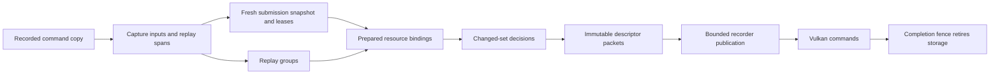

# Connected resource preparation

## Foundation and objective

The foundation is release 0.9.1, commit `ef3466ce4f8f27b750171d32b5275ba291c43e55`.
Release 0.9.0 is `fbd4067460198aaa826fead0b06719ae2b1b1553`. The later release keeps
the size-aware texture alias selection, initialized stand-ins, and texture retention fixes.
Its three replay workers remain the primary configuration; zero workers is a separate
diagnostic condition. Asynchronous replay remains disabled.

The implementation target connects command recording, submission-time resource
capture, prepared binding instances and their replay consumer. Texture dependency
tracking is one component of this path. The texture representation and shader
calculations remain the same.

This is an experimental implementation, not a measured performance claim. The old
renderer remains the fallback and the reference for differential checks. Its existing
visual defects are not an authoritative specification of the original game.

The validated change-driven checkpoint includes aggregate snapshot proofs and
front-pass draw runs. Its native build, four focused host checks and four saved-route
correctness runs passed; its identity is recorded under "Change-driven correctness
checkpoint" below. The working source now also contains compiled state execution and
front-pass summaries under integration. Their initial native build passed, but the
Field checking run found a descriptor mismatch. A corrective texture-cache revision
is being prepared for a fresh native correctness gate. Performance testing remains paused.

## Connected work

| Stage | Prepared output and consumer | Work replaced |
|---|---|---|
| EndRecording | Unique uniform capture inputs, replay spans, deferred-bind and texture-pin offsets appended to the immutable command copy | Repeated capture requests and later complete command walks for planning, deferred resolution, clone pin acquisition and retirement |
| Submit | Deferred payloads resolved from their index, uniform ranges gathered from the capture plan | Repeated opcode classification and duplicate requests; bytes are still captured at the original boundary |
| Replay planning | Ordinary state/draw spans with exact operation and draw counts | Group read-ahead walks; target changes, clears, mesh restrictions and ordered updates remain explicit boundaries |
| Snapshot resolution | A capture identity and region lease consumed by prepared uniform bindings | Repeated range search and invalidation caused by drops to other captured regions |
| Pipeline binding preparation | Recipes for fixed resource classes, stages, slots, descriptor counts and packed positions | Reinterpreting those decisions for each binding build |
| Draw/dispatch binding | Context-owned resolved descriptors in the order the Vulkan template consumes | Rebuilding descriptor keys and copying unchanged per-binding results into another scratch array |
| Descriptor emission | Immutable per-set packets and allocated sets owned by the submission completion fence | Repeated signature copying, descriptor updates and compute set allocations when the resulting bindings are unchanged |
| Recorder handoff | Retained packet references and bounded publication scopes | Copying templated descriptor payloads again and publishing every small command separately |
| Texture freshness | Region dependencies and clean certificates consumed by texture resolution | Repeated freshness discovery for already proven unchanged entries |

The first three stages are implemented in `nvn_api_cmd.c` and `vk_usnap.c`.
The recipe and consumer implementation is integrated in `vk_exec_draw.c`,
`vk_bind_recipe.c` and `vk_bind_prepared.h`.
Existing whole-binding skips, per-binding caching, descriptor templates and texture
memos in release 0.9.1 are the baseline; their benefits are not counted as new work.

`NX2NAVI_RESOURCE_PREP=1` selects the new command and binding path; `check` or `2`
adds correctness oracles. Unset or `0` selects the reference path. Package runs also
select the texture dependency mode below. The switches are fixed at process startup.

Command metadata consists of offsets, not pointers into the recording. A deferred
submission clone includes its own command bytes and metadata tail. The index registry
keeps retired copies and clones until their original replay lifetime ends. Raw command
arrays used by backend probes retain the reference walker. Texture pins are still
acquired and released with the original recording ownership rules.

A uniform lease holds an active capture identity and region index, never a region
pointer. Begin/end and arena reuse invalidate old leases. A GPU write invalidates the
overlapping captured region at its stream epoch; an earlier replay worker may still
use that region, and must check again when its epoch advances. An unrelated region's
drop does not invalidate the lease. Live-memory fallbacks retain their existing
generation and ordered-resolver requirements. No captured bytes are shared between
submissions merely because their guest address stayed the same.

Interim validation is limited to correctness, integration and obvious regressions.
Standalone FPS changes do not select or reject prerequisites. The earlier texture-only
matrix is paused after `kokiri-primary-p5-reference`; its remaining rows and existing
results are preserved as an incomplete experiment. Performance evaluation resumes
on the assembled package in both Kokiri Forest and Hyrule Field, retaining the routes,
fixed-cache identity and preparation-obstacle reporting described below.

`tests/resource_preparation_check.py` runs the actual command-copy and snapshot
implementations with host-only platform stubs. It checks cloned deferred payload
isolation, pin lifetime, retired-handle metadata, indexed and reference gathering,
capture/arena reuse, ordered GPU drops, range/alignment rejection and asynchronous
capture adoption. `--ubsan` enables undefined-behavior traps. These checks do not
replace GPU rendering and concurrent replay validation of the assembled package.

## Assembled validation checkpoint

The combined native build completed on the 0.9.1 foundation. Four saved-route smoke
runs completed with exit code 0: Kokiri and Field in combined checking mode, followed
by each route with the actual prepared-binding and texture fast paths enabled.
All used the existing saves, scripted routes, three replay workers, native output
resolution and frozen cache policy. No component performance matrix was resumed.

The checking runs exercised descriptor comparisons without reporting a mismatch.
The normal runs reported actual prepared descriptor and snapshot lease reuse.
Native screenshots at matching route times were inspected against the preserved
pristine build: no obvious new terrain, foliage, water, lighting or UI defect was
found. Animation and camera positions differ between live runs; this is not a
pixel-equivalence result or a full-game compatibility claim.

The Field fast-path smoke run encountered a background pipeline creation, pending
resource/held-frame events and 12.9 ms of pipeline creation in a counter window
touching movement. Those events remain in its record. All four runs are correctness
runs with screenshot capture and are excluded from headline timing comparisons.
No repeat was added to obtain a cleaner or more favorable performance result.

Artifacts in the ignored collaboration workspace are `assembled-source.json`,
`assembled-build.json`, and runs `assembled-kokiri-check`, `assembled-field-check`,
`assembled-kokiri-fastpath`, `assembled-field-fastpath`. The executable SHA256 is
`42d3b7accf6f8caa59b588baed6153fc7c51af815e89cc9ce9edd8064f16324a`.
That checkpoint used the frozen source snapshot and predates the expansion below.
CPU checks, native build and these limited route checks establish the earlier
integration checkpoint; they do not establish an FPS improvement.
The earlier focused texture probe and its baseline full-suite
limitations remain as documented below.

## Expansion after the preliminary comparison

The preliminary package comparison was stopped at the user's direction after ten
completed runs. Its final two Field runs were cancelled before launch. The frozen
protocol, completed logs and earlier incomplete texture-only matrix remain intact.
No component is selected or rejected from those partial measurements. Game launches
were paused during implementation. The user subsequently authorized the bounded
four-route correctness gate recorded below; performance testing remains paused.

The expanded producer emits `NvnRecordPlan` at `flatten_recording`. The plan has the
command copy's lifetime and contains offsets, counts and classifications, never
resolved GPU objects or previously captured uniform bytes. Submission clones copy
the plan with their command bytes. Deferred payload resolution does not change its
structure. The indexed registry retains plans for queued retired recordings until
their existing replay lifetime ends; raw backend commands keep the reference path.

Uniform capture requests are deduplicated by address, size, stage and bank. Keeping
the latter two is necessary because motion reconstruction may also capture neighbouring
blocks for particular banks. `vk_usnap.c:collect` consumes those unique inputs and
still resolves neighbour eligibility, current imported storage and in-flight GPU writes
at the submission boundary. GPU writes inside the submission still drop leases at
their ordered epoch. Reusing a capture recipe does not reuse old memory contents.

Replay spans combine ordinary state and draw operations while retaining exact counts.
Target changes, clears, mesh draws, inline uniform updates and serial operations
remain explicit. `vk_exec.c:group_peek_plan` consumes the spans, evaluating the same
current render-target and mesh-mode conditions as `group_peek`. Interior resumes and
read limits that cannot be answered exactly use the reference walker. At that checkpoint,
the front pass and workers still executed every original operation in its original order. Checking
mode compares planned groups with the complete reference walk. The expanded
correctness checkpoint below exercised this path on both saved routes.

Builder scratch belongs to one recording operation at a time and is recycled through
a bounded pool: at most eight cached builders, each at most 4 MiB. Larger allocations
are released after building. This replaces scratch allocations tied to guest thread
lifetimes, so temporary recording workers cannot leave their plan buffers behind.
The existing memory-size report includes the cached scratch, and replay summaries
report plan consumption and fallback walks without adding per-operation timers.

`vk_bind_prepared.h:prepared_resolve` now marks the sets whose resolved descriptor
bytes changed. Unchanged sets retain an immutable packet and, where applicable, their
allocated descriptor set. Resource validation and ordered writable-buffer, image and
pool actions still run. A new command buffer resets its bound-state shadow, while
prepared results survive only within the same context, completion fence and uniform
capture. Every resource still needs its current lease, generation or slot proof.
Graphics and compute keep separate shadows. Mesh-scan, backend antialiasing and
tonemapping dispatches invalidate the compute shadow before a game dispatch reuses it.

Packets belong to `CbRes`, released by `cb_done` through the actual completion
timeline. Earlier split parts cannot release them while later parts are being
recorded: that timeline is signalled by the final submission. Existing allocated
sets and published packets are never rewritten. A changed set receives new storage.
The host packet arena uses 64 KiB blocks and caps each context/fence owner at 8 MiB,
then uses the original copying path. Completed blocks retain at most 1 MiB globally.
Concurrent contexts and outstanding fences multiply the possible live footprint;
these limits are not a process-wide 8 MiB cap.

`vk_rec.c:rec_push_tpl_retained` publishes a reference to those immutable bytes.
Publication scopes cover draw, mesh, dispatch and uniform-update operations; pure
state/bind operations and direct worker command buffers do not enter them. A batch
publishes after 32 packets or 4 KiB, or at the outer operation's end. Ring pressure,
drains, direct-call fallbacks and command-buffer transitions force publication.
Arguments are complete before the release publication, and the recorder acquires
that publication before consuming them. No per-packet timer was added.

`RESOURCE_PREP=check` adds independent command-plan and packet-byte
comparisons. `REC_CHECK` deliberately retains copied payloads and per-packet
publication for its existing handle scanner; it therefore does not exercise the
new retained-reference or batching paths. The correctness gate therefore includes
normal runs with `REC_CHECK=0` and the actual retained-reference and batching paths.
Full replay state execution, changing resource resolution and existing barriers
remain. Reusing executable Vulkan command buffers across frames or relaxing those
barriers would need additional resource-access and lifetime proofs; neither is
implied by this packet and planning work.

## Expanded correctness checkpoint

On November 12, 2026, the focused command-copy and snapshot checks passed with
undefined-behavior traps, and the recipe/prepared-binding checks passed. These cover
clone isolation, retirement, deferred reads, capture reuse, ordered drops, recipe
mapping, command-buffer changes, completion-fence resets and changed descriptor packets.
The native build also passed. Four producer-only recorder counters were added to
the existing log cadence to establish retained-reference and publication coverage;
they add no per-operation clocks or changes to recorder behavior.

Exactly four game traversals completed with exit code 0: Kokiri and Field in
combined checking mode, then both routes in normal optimized mode. All used the
frozen save, route, settings and original application-cache seed. Raw logs showed
no assertion or mismatch, both checking runs reported no recorder hazards, and
their descriptor, dependency and command-plan checks were active. The normal runs
reported prepared-binding and snapshot reuse plus positive retained-push and
publication-deferral counts. Those counts establish execution, not CPU time saved.
All 22 native captures were inspected against preserved pristine route captures;
no obvious new terrain, foliage, water, lighting, character or UI defect was found.
Before/after observations found no competing game processes or external-thread change.

The Field checking run retained five translations, pending-resource/held-frame
events, three background pipeline creations and 45.3 ms of creation in counter
windows touching movement, plus one compute pipeline created at first dispatch.
The Field normal run retained one background pipeline creation and 3.8 ms in a
touching window. Neither Kokiri run reported a preparation flag. These events are
not hidden or retried; they qualify future warmed timing comparisons. All four
capture/checking runs are excluded from performance conclusions.

The tested executable SHA256 is
`9c33ab21e8ff21167a4c12af6b95248b1826de273d31ab86c975d310cd299526`,
with source overlay
`0eb4954d42e25486e065d402f20a1f3c5b7f9ca446fdcf8733e4517484c41665`.
The ignored collaboration workspace retains `expanded-correctness-protocol.json`,
the `expanded-coverage` source/build artifacts and all four `expanded-*` run folders.
Independent evidence is in
`build/resource-preparation-review/expanded-correctness-independent-review.json`
and its capture inventory `expanded-visual-review.json`. This is a bounded smoke
pass sufficient to proceed to a declared package benchmark; it is not full-game
compatibility, pixel or temporal equivalence, an exhaustive concurrency proof,
or evidence that Vulkan validation layers were enabled. No benchmark was resumed.

## Change-driven consumer and aggregate proofs

The previous expansion reused resolved descriptor bytes but still visited each
descriptor to establish reuse. The new consumer connects binding notifications to
resident resource groups, so an unchanged group can skip those visits. This removes work only when
the input and resource proofs both hold; a stable guest address alone is insufficient.

`vk_bind_recipe.c:vk_bind_recipe_create` records each operation's input location,
packed descriptor position and eligibility for reuse. Ordered operations stay in
their original positions. Recipes outlive individual submissions, but contain no
captured bytes or resolved resource ownership. Each recording context has sixteen
resident instances, arranged in four-way associative groups. Slot and descriptor
storage has a separate 2 MiB context limit. Eviction unregisters its reverse dependency
bits before reusing a resident index. Fixed proof and dependency tables are additional
context storage; immutable packet storage retains its separate fence-owned budget.

Each Vulkan descriptor set has separate buffer/constant and sampled-texture proofs.
The pipeline's independent sets partition shader stages, not resource classes, so a
single object-buffer change must not invalidate unchanged textures in the same set.
The reverse dependency tables map explicit uniform, storage-buffer and texture inputs
to resident set bits, with separate dirty words for the two proof groups. Bind commands
compare their effective address/size or handles and dirty only affected groups.
Rebinding an identical input does not dirty either group. The final descriptor packet
still belongs to the whole set and changes when either group's descriptor bytes change.
Copied replay state bypasses these notifications, so `vk_exec_draw_state_adopted`
dirties all resident input proofs in the actual destination context. Worker entry,
held-state swaps and restoration of a helping context invoke this hook. Starting a
new Vulkan command buffer separately resets bound-state shadows; it does not alone
invalidate the same submission's resource proofs.

| Change | Required response |
|---|---|
| Explicit input changes | Dirty the subscribed resource groups within resident sets |
| Worker or continuation adopts copied state | Dirty all input proofs in that context |
| Completion fence or capture identity changes | Discard resolved slot proofs and retained packet/set references |
| Snapshot region is dropped | Publish its dependency bucket and ordered drop epoch |
| Consumer reaches an already known future drop | Reject the aggregate at its earliest relevant horizon |
| Live-memory mapping, program constant or texture prerequisite changes | Reject the matching aggregate guard and resolve normally |
| Ordered resolver changes validity during a set | Recheck group guards before skipping later reusable operations |
| New command buffer or backend helper changes Vulkan bindings | Emit bindings again from still-valid prepared results |

`vk_usnap.c:vk_usnap_proof_begin`, `vk_usnap_proof_add` and
`vk_usnap_proof_end` construct a context-owned aggregate over exact snapshot leases.
The proof records the capture, construction epoch, publication serial, dependency
buckets and earliest future drop among its members. Construction must start before
resolution and finish without a publication or epoch change. A conflicting writer
prevents sealing; the consumer falls back rather than spinning.

There are 64 dependency buckets. Region collisions cause conservative rejection,
never permission to reuse stale bytes. A stable global publication serial makes
validation constant-time. After an unrelated publication, validation compares only
the buckets used by that proof. Writers bracket actual drop changes with an odd/even
serial and publish touched buckets before completing the serial. Earlier workers may
use a snapshot that a later stream operation drops, but only until their proof's
ordered horizon. Proofs are mutable context state and are not concurrently shared
between recording workers. Immutable recipes and command structure are shared;
each worker establishes its own resource proof.
Reference mode retains its original drop and generation behavior without publishing
the additional aggregate metadata.

The consumer also guards live memory, program constants, sampler and texture slot
generations, texture freshness epochs, pools and feedback layouts. Exact-level texture
promotion, storage writes, dynamic support data, constant-buffer reconstruction and
override-dependent cases retain their explicit resolvers. Mixed sets still reuse
eligible operations around them. Guard checks occur again after any executed
resolver before a later operation is skipped. No ordered action is moved to the end
of a set merely to make the reusable operations contiguous.

Supported recipes bypass the older whole-binding signature and per-slot skip scan,
so those checks are not paid in addition to the aggregate checks. When descriptor
bytes remain equal, the consumer retains the existing immutable packet or allocated
set. Memory-use accounting aggregates skipped stable descriptors by resource class
and use; partial skips retain their precise contributions. Unsupported recipes and
capacity limits keep the existing resolver path. Optional resident allocation failure
also falls back rather than terminating rendering, with retries bounded by submission.

Preparation coverage counters accumulate locally during recording. Chunk and
submission completion publish them to a separate atomic bank; the replay thread
collects that bank before logging and resetting frame totals. This avoids shared
per-descriptor updates for the new counters. A collection concurrent with a worker's
publication can split related counts between adjacent windows without losing totals.
Existing unrelated renderer counters retain their previous behavior.
The preparation log's `descriptors` counts requested contributions in supported recipes;
`aggregate-skipped` counts contributions bypassing their per-descriptor resolver or
validator entirely. Their difference counts ordinary descriptor-path visits.
`proof-descriptors` separately counts descriptor visits while building aggregate proofs;
those visits must be included when assessing total preparation work, even when a proof
fails to seal. These are work counts, not estimates of CPU time saved.
`reused` includes both aggregate skips and ordinary per-slot reuse and must not be
reported as entirely new work removed. Checking mode deliberately executes the skipped
path's oracle and is not used for its performance measurement.

The command producer also marks homogeneous runs of at least four ordinary draw
records, with exact stride and counts and at most 1024 records per span. Short runs
collapse back into ordinary state/draw spans to limit metadata growth. The replay
front pass consumes these runs directly, clipped at each chunk boundary, preserving
query reservation and draw counts. Recording workers still execute each original
draw. State changes, mesh draws and ordered operations cannot enter a homogeneous
run. Checking mode walks the original records as an independent shape oracle.

Test sources cover aggregate construction, unrelated writes, future and earlier
replacement drops, capture retirement, copied input invalidation, resident eviction,
mixed ordered/reusable operations, unchanged textures beside changing object buffers,
and draw-run clone/interior/chunk limits. They passed for this revision, followed by
the bounded execution gate below. Source review and these tests do not establish
exhaustive concurrent replay correctness, image equivalence or performance. No earlier
FPS result is a measurement of this revision.

## Change-driven correctness checkpoint

On November 12, 2026, the current change-driven implementation built successfully
and passed `command_index_check` and `usnap_lease_check` with undefined-behavior
traps, plus `bind_recipe_check` and `prepared_bindings_check`. The command-index
test initially expected an unpadded draw-record stride. Its assertion now accounts
for the eight-byte stream alignment and also checks the recorded header's size.
This was a test expectation fix; no runtime change was needed during this gate.
The initial failure and passing rerun are both retained.

Exactly four saved-route traversals completed with exit code 0. Each scene ran once
with `RESOURCE_PREP=check`, `RESOURCE_DEPS=check` and `REC_CHECK=1`, then once with
`RESOURCE_PREP=1`, `RESOURCE_DEPS=integrated` and `REC_CHECK=0`. Kokiri retained its
15-second movement and recenter; Field retained its 65-second sprint through the
larger environment. The scene saves, input scripts, application-cache seed and
three-worker synchronous replay configuration were preserved. Each checking run
executed descriptor comparisons and reported no recorder hazards. Both normal runs
reported positive aggregate skips, retained packet pushes and publication deferrals.
All four exercised structural draw-run planning. These counts establish execution
coverage and do not estimate CPU time saved.

All four final boot summaries reported zero unimplemented calls, internal validation
errors, shader failures and skipped draws. No assertion, mismatch, device loss or
recorder hazard was found in their logs. All 22 native captures were independently
inspected against preserved reference-route images, including water crossings and
the Field approach to the castle. No obvious new terrain, foliage, water, lighting,
character or UI defect was found. Static captures cannot establish temporal
equivalence, and differing animation, particles and camera positions preclude an
exact pixel comparison.

The runs used background window mode with no activation, scripted input, physical
input disabled and a silent audio sink. Other user software was allowed and remained
running; its effect on scheduling is irrelevant to a timing conclusion because no
timing conclusion is made. Windows fitted the requested 3440 by 1440 window to a
3346 by 1400 client; native pre-present captures are 3416 by 1440. The historical
references were fullscreen. These dimensions and background conditions are recorded
as comparison limits. Internal error counters do not establish that Vulkan validation
layers were enabled. This remains a bounded route pass, not a full-game compatibility
or exhaustive concurrency proof.

The tested executable SHA256 is
`d8993170391cc0aa4a729a237f64765b2bc252121b8be21915adb532c7d6bafc`.
It was built from the frozen overlay
`ea3f5085f7f6b47ef4acf48d4bfc6b2e79e136735cf6fdac9153814ed3c57635`.
The build manifest records the later test-only amendment separately. Independent
verification matched all 330 runtime source files between the built manifest, frozen
source and working tree. The archived source-only manifest remains historical rather
than being rewritten to claim that it already contained these results.

The ignored collaboration workspace retains `change-driven-build.json`,
`change-driven-source-built.json`, `change-driven-correctness-protocol.json` and the
four `change-*` run directories. Independent evidence is in
`build/resource-preparation-review/change-driven-cpu-correctness.json`,
`change-driven-visual-review.json` and
`change-driven-correctness-independent-review.json` in the same review directory.
No performance benchmark or FPS/frametime comparison was performed for this checkpoint.

## Compiled command execution

`nvn_api_cmd.c:flatten_recording` now builds an immutable executable program alongside
the existing resource indexes. Ordinary operations retain a handler chosen during
recording. Consecutive pure state operations compile into a delta of their final
writes, with source offsets into the current command copy and destinations fixed by
the backend's queue-state layout. Repeated and overlapping writes are folded before
replay; vertex-array replacement keeps its zero-fill semantics. Resource-input dirty
masks follow final input changes, while binding and texture generation increments
retain their original totals. Invalid or diagnostic-producing inputs remain explicit
operation boundaries.

The main walk and recording workers consume this program. Source offsets make
deferred handles belong to the actual submission clone; programs contain no copied
guest memory contents, resolved images, pipelines or descriptors. The immutable
metadata shares the command copy's lifetime through queued retirement and cloning.
Texture lookup retries retain the original operation address and ordering. Raw probe
commands and an execution slice beginning or ending inside a state block keep the
original walker until an exact prepared boundary is reached. Per-operation diagnostic
modes keep the uncoalesced path.

A separate front-pass program folds pure state writes across small runs of ordinary
draws. The front pass already skips executing those draws; it needs final queue state
at each worker boundary and the exact operation/draw counts for scheduling and query
reservation. A summary is applied only when its complete interval fits the current
group and remaining chunk draw budget. Targets, queries, conditional rendering,
clears, pools, mesh draws, transfers, events and updates remain boundaries. Recording
workers still execute the primary program and emit every required draw in order.
This preserves intermediate draw state while eliminating state assignments that the
front pass would overwrite before its next observation point.

The next producer revision builds these front summaries by composing the primary
program's retained state writes. It decodes only isolated state operations that did
not form a primary block. Composition consumes whole primary steps and preserves
the original operation counts, generation increments, draw limits and ordering
boundaries. A full block that would exceed a summary's limits stays for the next
summary or ordinary replay; it is never partially applied. The original source
compiler remains a differential reference.

Primary blocks and appended summaries share one allocation. Composition finishes
reading the primary prefix before its emission callback can grow that allocation,
and subsequent calls use the new address with the original prefix length. The
command-copy fixture exercises this growth and verifies that copied summaries read
deferred handles from the current submission clone. This producer revision is a
separate code-only follow-up; it does not modify the frozen corrected executable or
establish a game-performance result.

Optional execution metadata is bounded to 16 MiB per command copy. Admission or
allocation failure retains the existing resource indexes and ordinary execution.
Compiler scratch returns through the bounded recording-builder pool. Execution
coverage counts accumulate locally and publish at walk, chunk and group boundaries;
they introduce no per-operation atomic update or timer. Counts distinguish compiled
state operations, typed operations, reference operations and draws covered by front
summaries. They establish which paths execute, not time saved.

The host command-copy test uses the production state compiler to check clone-relative
deferred sources, retained lifetimes and every interior slice of a short recording.
The state differential fixture compares compiled effects with the scalar state
handlers, including compact variable-length records and overlapping assignments.
These checks do not replace the pending native build and saved-route correctness gate.

The initial compiled-execution executable built and passed the Kokiri checking route.
The Field checking route then stopped with `prepared descriptor 10 differs from ordered
resolution`. Both artifacts are preserved. One diagnostics-only Field reproduction
completed without repeating that failure; it does not establish the original cause.

A deterministic host fixture subsequently exposed a stale-generation defect in the
production image-binding loop: resolving one array member could change the texture
table before a later member checked reuse against the generation sampled at loop entry.
The corrective path samples each member's guards separately and rechecks a checking-mode
hit after acquiring the texture lock. The fixture also follows the actual shared texture
memo: deferred lookups cannot certify placeholders in either cache, an epoch freshness
check revalidates its slot token, and incomplete draws cannot seal aggregate proofs or
serve as completed oracle comparisons. Typed mismatch diagnostics remain available.
These repairs address confirmed host cases; they are not a conclusive attribution of
the earlier Field failure. The corrected native gate is pending.

## Draw preparation follow-up

The next isolated code milestone retains completed shader selections in a bounded
cache owned by each recording context. It operates at shader stage granularity, so
intervening programs or an unchanged stage of a different draw need not repeat
answer construction, hashing and lookup under the shared shader-table lock.

The stage key follows `vk_exec_draw.c:answers_for` and
`vk_pipeline.c:vk_pipeline_answers`. Vertex selection depends on attribute formats;
fragment selection depends on color target formats. Each stage also depends on its
program serial, required texture/image handles and their resolved types. The vertex
motion variant is a separate input. Other stages obtain their local size from the
program's immutable control data. Blend, depth/stencil, culling, attribute offsets
and vertex stream strides are not shader-selection inputs.

Selected handles are compared explicitly on every hit. Queue state can be copied
into workers, continuations or speculative lookahead with equal counters and
different bindings; a texture serial alone is not an identity for those inputs.
Nonempty texture dependencies retain conservative global-generation invalidation.
Pending, failed and deferred selections cannot enter the packet cache. Changes to
the generation or learned dependency mask during lookup also prevent admission.

The underlying texture-answer cache must obey the same completion rule. It samples
guards per member, rechecks them after taking the texture lock and invalidates an
incomplete member. Partial answers cannot reach the shared shader table or seed a
translation before the operation is retried in order. This is necessary even when
the outer packet refuses to store a result.

Caller handling must distinguish an incomplete selection from a failed shader.
Compute dispatches return before invoking fallback work, and graphics selection
returns before failure accounting. Per-object motion preparation occurs after the
primary indexed draw. If it defers, no incomplete motion record is published; the
renderer releases the motion-list lock, ends the current pass, waits for its ordered
turn and retries only motion preparation. It retains the primary state and command
buffer bindings across that wait. The already emitted primary draw is not replayed.
A second deferral after taking the ordered turn is an invariant failure.

Reference mode bypasses packets. Checking mode compares a packet hit with the
ordinary resolver. Host fixtures must exercise relevant and irrelevant state
changes, alternating programs, copied states with equal counters, dependency-mask
learning, pending completion and deferred retries. Resolver call counts demonstrate
eliminated work in these fixtures; they do not establish an in-game speedup.

This milestone preserves draw ordering, resource preparation, feedback handling,
dynamic state and shader/pipeline readiness policy. Its implementation and checks
remain separate from the frozen corrected native candidate; gameplay validation
and performance testing are pending.

## Incremental resource-proof renewal

`vk_bind_prepared.h:prepared_resolve` distinguishes changed binding inputs from invalid
resource certificates. When the old resource group remains valid but its inputs changed,
ordinary resolution records the refreshed descriptor contributions. Resealing can retain
the certificate for untouched contributions and validate only the refreshed ones. Resource
census totals subtract each replaced contribution before adding its replacement, and
snapshot contribution counts follow live-to-snapshot and snapshot-to-live transitions.

`vk_usnap.c:vk_usnap_proof_inherit` validates a private copy of the previous certificate
within a new publication bracket. Capture identity, replay epoch, publication serial,
dependency versions and the earliest future-drop horizon still constrain reuse. Retaining
old dependency buckets and a conservative horizon can reject additional reuse; it cannot
permit a stale snapshot. The donor certificate is never mutated by inheritance.

A failed renewal falls back to full group validation and rebuilds its census and snapshot
counts, including failures after partial progress. A successful renewal publishes the new
group only after the closing checks pass. `renewals` and `renewed-descriptors` count successful
renewals and their individually revalidated contributions; `proof-descriptors` includes all
attempted validation visits, including failed renewal work. None of these counts measures
time saved. Texture identities already retained by the baseline still require submission
freshness checks; this work does not bypass those checks across submissions.

## Remaining renderer work

The compiled execution milestone removes repeated command classification and redundant
state assignments from eligible paths. Each required draw still reaches its ordinary
backend implementation. It does not complete the following work:

- Persistent resource readiness across submissions needs content, upload, alias and lifetime
  certificates. Current capture identities and ordering checks remain authoritative.
- Draw merging, indirect batches and reusable Vulkan command segments need compatible
  pipeline, target, descriptor, dynamic-state, query and resource-lifetime contracts.
- Reducing synchronization needs resource-access summaries that justify individual barrier
  and wait changes. The current execution plans preserve existing synchronization.
- Guest visibility, scene draw-list generation, per-object work, streaming and decompression
  need game-specific recovered contracts beyond the backend command processor.

The assembled execution milestone warrants a package performance comparison after its
native build and bounded correctness gate. Completing all longer-term work is not a
prerequisite for that comparison. Performance testing remains paused until authorized.

## Data and lifetime contract

1. The existing memory generation lock and submission snapshots remain authoritative.
   Direct CPU writes without an NVN flush still require write-watch observation.
2. Each listed CPU-backed texture subscribes to every 2 MiB region its storage covers.
   A unique-region observation queues affected entries. Untracked or unsupported ranges
   and entries without valid uploaded content cannot become certified clean.
3. Entry removal unlinks all subscriptions and pending queue membership before destruction
   or node reuse. Numeric addresses and recycled handles alone never identify a lifetime.
4. Candidate entries retain the existing descending processing order, release checks,
   GPU-ownership checks, upload behavior and submission epoch rules.
5. A downstream binding can use a clean certificate only in the observed submission,
   for the same entry/range and an uploaded generation at least as new as the prepared
   proof. The global observation serial must match, or the covered regions must have no
   publication after its captured watermark. Any uncertainty invokes the existing path.
6. Content freshness is separate from descriptor identity. Existing texture-slot tokens,
   alias resolution, descriptor-set sealing and fence retirement remain authoritative.
7. No wait, barrier, GPU write-back merge, uniform capture boundary or command is removed.

## Experimental modes

`NX2NAVI_RESOURCE_DEPS` selects `reference` (the default), `observe` (dependency
maintenance with the reference consumer), `worklist` (affected-entry refresh with the
old direct binding lookup), `integrated` (worklist and binding certificates), or `check`
(integrated behavior plus differential assertions). `NX2NAVI_RESOURCE_DEPS_TIME=1`
enables the diagnostic timers; performance runs leave it off.
Optional consumer ablations must keep all required producer dependencies enabled.
Checks compare candidate coverage and certified-clean answers before skipping work;
they do not invoke uploads or other state-changing operations twice.

`NX2NAVI_RESOURCE_DEPS_ORDER=original` preserves the original listed-entry snapshot
query order before observing dependencies. The default observes unique regions in
address order. This diagnostic separates dependency reuse from the timing effect of
changing the write-watch queries. An oracle evaluated after those queries cannot prove
that their timing was equivalent, so both orders require game validation. Unsupported
ranges and loss of tracking remain conservative. A detected generation discontinuity permanently
returns this experiment to the reference path for the process.

The implementation reports entries considered, unique regions observed, queued entries,
fallbacks, certificate hits, maintenance cost and refresh cost. Diagnostic timers are
separate from low-overhead performance runs. Coverage alone is not a speedup.

The existing renderer already checks a directly bound texture at most once per
submission. Certificates target that first check after preparation passed the entry;
they do not remove every descriptor lookup. Observations publish a 64-bit serial for
their affected region before updating the global watermark, under the generation lock.
A changed global serial can therefore retain a certificate when its own regions have
no newer publication. This preserves a previously established tracked snapshot; it
cannot establish freshness by itself. Mapping changes still reject certificates
globally. Rejection counters distinguish metadata, generation, owner and dirty-node
failures, alongside regional preservation attempts. Existing binding caches, alias
resolution and resource retirement still run. No speedup is assumed for rare reuse.

The atomic stamps are not an indivisible snapshot of the generation table. The fast
path that sees an unchanged global watermark can finish before an overlapping writer
publishes its new watermark. A reader acquiring a newer global watermark sees the
regional publications preceding it. The existing replay and completion dependencies
must still order any observation required by that binding. In `vk_sync.c`,
`completion_main` finishes completion callbacks before publishing `done`; fence checks
and waits acquire that publication. This experiment removes none of those waits.
Checking mode rechecks under the generation lock to avoid comparing answers from
different observation boundaries. Route checks exercise these interactions but do
not exhaustively test every concurrent interleaving.

The first in-game checking run exposed two consumer prerequisites: unrelated memory
observations rejected certificates globally, and a direct fallback could advance the
texture's generation while the pool retained its older clean proof. Requiring equality
then prevented later reuse. A clean proof since an older generation also holds since a
newer uploaded generation, until another relevant observation. The revision preserves
that monotonic relation and checks regional publications; it retains the original
predicate as its checking-mode oracle. The first run's very low certificate coverage
is a finding about that implementation, not a verdict on the complete approach.

## Validation and measurement

Use isolated saves, settings, binaries and application caches. Preserve the original
Kokiri Forest and Hyrule Field saves and the desktop build. A frozen manifest identifies
source revision and diff, executable, save, shader translator, settings, GPU/driver,
route, worker count and preparation state.

The first gate is a native build and deterministic plus randomized production-module
tests for subscriptions, cross-region ranges, duplicate notifications, untracked data,
removal/reuse, capacity growth and conservative failure. Differential game runs then
exercise both routes with all original ordering protections. Visual checks include
terrain, foliage, lighting, transient effects and streamed resource replacement.

Measure the whole prescribed movement interval, including every hitch. Kokiri is the
primary repeatable route; Hyrule Field exercises a larger streamed workload. Distinguish
warmed traversal from first-visit/preparation behavior. Verify pipeline readiness rather
than assuming it from an earlier launch. Compilation or external activity makes a run
ineligible for the warmed comparison according to a rule applied to every configuration;
retain and report its data separately, without deleting individual slow frames.

Use balanced configuration order and repeated runs, including a pure-release control
and same-executable reference. Report host-presentation intervals, median and mean frame
time, p95/p99, worst frame and hitch counts. Keep CPU execution, waits, GPU work and
submission gaps separate: their overlapping scopes cannot be summed into frame savings.
Do not credit skipped draws, missing content, or changed image quality as an optimization.

A component with flat standalone FPS can remain useful if it removes measured work or
enables a named downstream removal. Evaluate the complete path and valid component
ablations. Record maintenance cost and correctness fallback coverage before attributing
a negative result to the architectural approach.

## Frozen primary routes

Both routes use 3440x1440 fullscreen, DLSS Performance, no frame generation, uncapped
presentation, three replay workers, `REPLAY_PIPE=0` and `REPLAY_ASYNC=0`. Settings and
shader preparation must match within each comparison. The historical measurements
are context only; fresh controls establish the baseline.

Kokiri starts from the preserved 00:28 save, recenters with ZL at world second 1 for
150 ms, and holds full forward stick from world second 5 for 15 seconds without sprint.
Hyrule Field starts from the preserved 20:37 save and holds full forward stick plus
sprint from world second 5 for 65 seconds, with no added recenter. These are movement
windows, not fixed wall-clock launch durations. The initial five seconds are retained
separately. Five accepted reference/integrated pairs per scene form the primary suite,
with balanced launch order. Valid component ablations use at least three repetitions.

During the declared suite, a tracking-only traversal encountered a pixel-shader program
absent from the frozen route inventory. Earlier clean readiness passes did not guarantee
complete route coverage. The response keeps the same cache seed and records all declared
first traversals, including their preparation stalls, alongside a separately qualified
warmed-pair subset. The original clean-pair target may therefore be unmet; compilation
does not become eligible merely because it is difficult to eliminate. Neither individual
slow frames nor unfavorable whole runs are replaced. Any bounded repeat is declared and
reported separately. A result including preparation cannot isolate this texture path's
CPU effect. The material or effect owning that newly observed shader was not identified.

The test harness owns a shared benchmark lease, not just a per-checkout lock. It uses
preserved save copies and an isolated executable and caches; it never replaces a desktop
executable. Concurrent game runs, builds or rendering work are checked before and after
each accepted run. Runs that fail preparation or activity eligibility remain recorded
with the reason. The benchmark does not claim a cold operating-system file cache.

## Local implementation checks

`tests/fresh_deps_check.c` links the production `runtime/fresh_deps.c` and compares its
subscriptions and dirty queue with an independent exhaustive model. It covers 100,000
random operations in addition to targeted lifetime, region-boundary, tracking-loss and
version-wrap notification cases. These container tests do not fix the reference
renderer's 32-bit ordered generation arithmetic. Build with UCRT64 Clang,
`-std=c11 -O2 -Wall -Wextra -Werror
-I runtime runtime/fresh_deps.c tests/fresh_deps_check.c`; write the executable to an
ignored build directory. A second build with `-fsanitize=undefined -fsanitize-trap=all`
checks undefined behavior without requiring an external sanitizer runtime.

These module checks passed locally. They do not establish game-wide visual equivalence,
net renderer performance, or the correctness of all interactions with GPU completion.

The candidate's `--probe-vkmem` also includes `tex_probe.c:test_prepared_texture`.
Seven image readbacks compare Vulkan pixels with the independent storage swizzler's
input: clean preparation, an unrelated-region write, reuse of an older clean proof
after an ordinary binding advances the uploaded generation, another write in the
same region, an explicit texture write, an unflushed post-snapshot write, and the
following submission. Snapshot counters assert that the intended bindings actually
bypass the original check and that invalidation invokes it. A matching image reached
only through fallback would not pass those path assertions. Watched modes also require
explicit writes to advance the publication serial. Run the focused probe in reference,
integrated and checking modes, including checking mode with the original observation
order. Retain execution logs with the binary identity.

`NX2NAVI_PREPARED_TEXTURE_PROBE=1` selects only this GPU readback test under
`--probe-vkmem`. The full probe failed its existing texture-release assertion on both
the unmodified control and candidate reference before reaching the new checks, followed
by a cleanup crash. Those failures remain recorded separately. The focused selection
does not constitute a pass of that broader suite and changes no saved-game behavior.
The focused entry point stops the completion thread before destroying the memory and
Vulkan state, as the normal backend shutdown does. It runs with unused DLAA initialization
disabled; saved-game tests retain their common DLSS settings. Successful logs without
validation errors are not evidence that Vulkan validation layers were enabled.

## Windows benchmark baseline

The Windows defaults enable prepared resources and integrated texture dependency tracking.
The measured Ryzen 7 7800X3D build used the normal Windows build with
`NX2NAVI_RENDERER_CPU=znver4` in the build environment. This selects ThinLTO for
17 renderer translation units and requires lld. Use the generic default for portable
builds. The bounded working-set query in memory.c applies in both builds. The reference
executable for the two Kokiri Forest runs and one Hyrule Field run had SHA-256
`5cdaab732d7808241528ce41a1c5226ae286f245d62a7288f8dbf947a03e73e1`.
